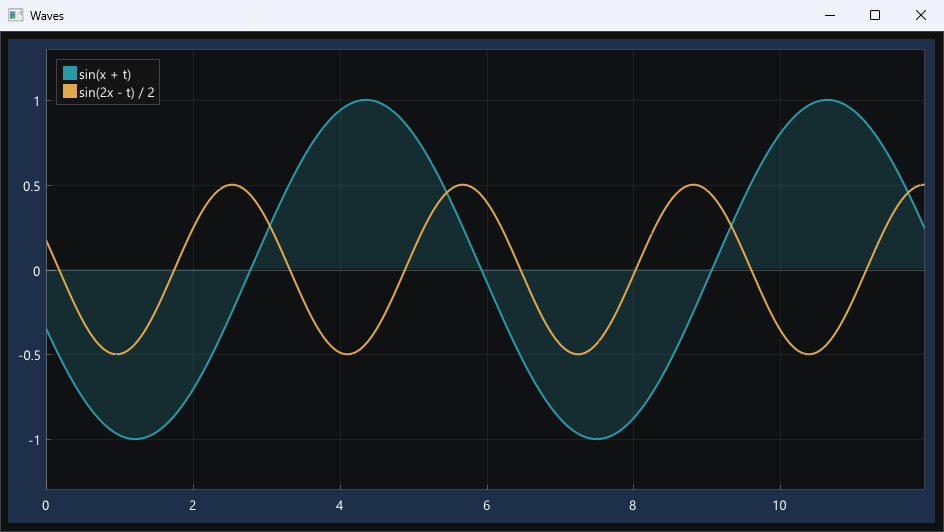
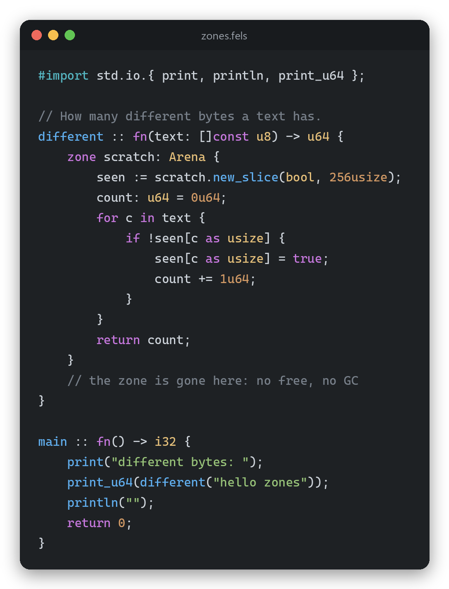
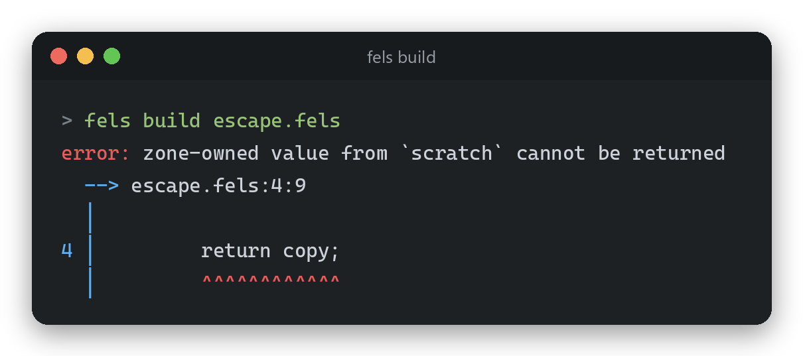
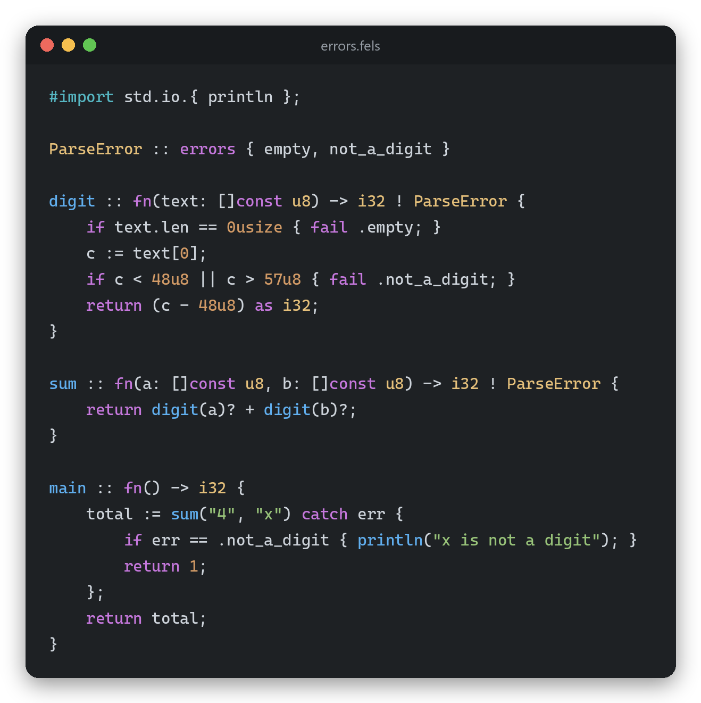
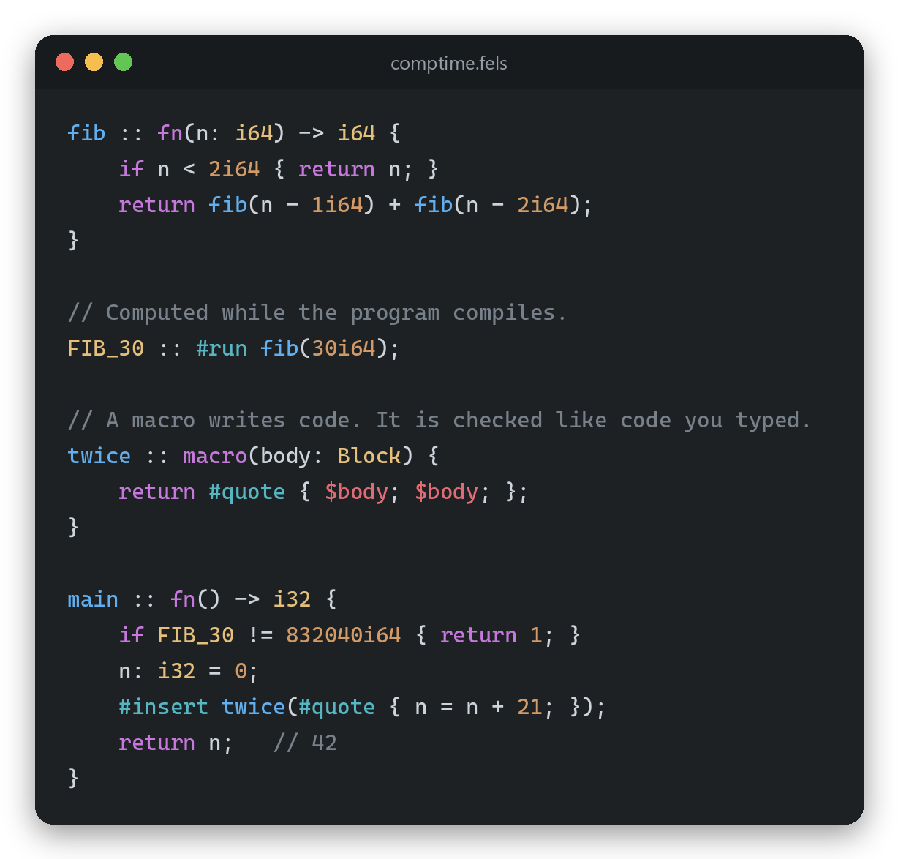
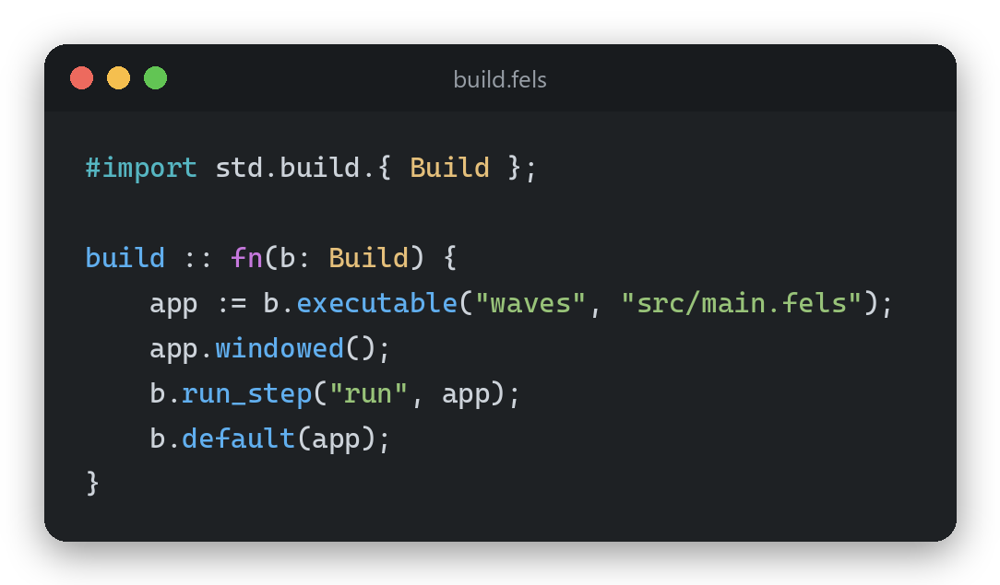
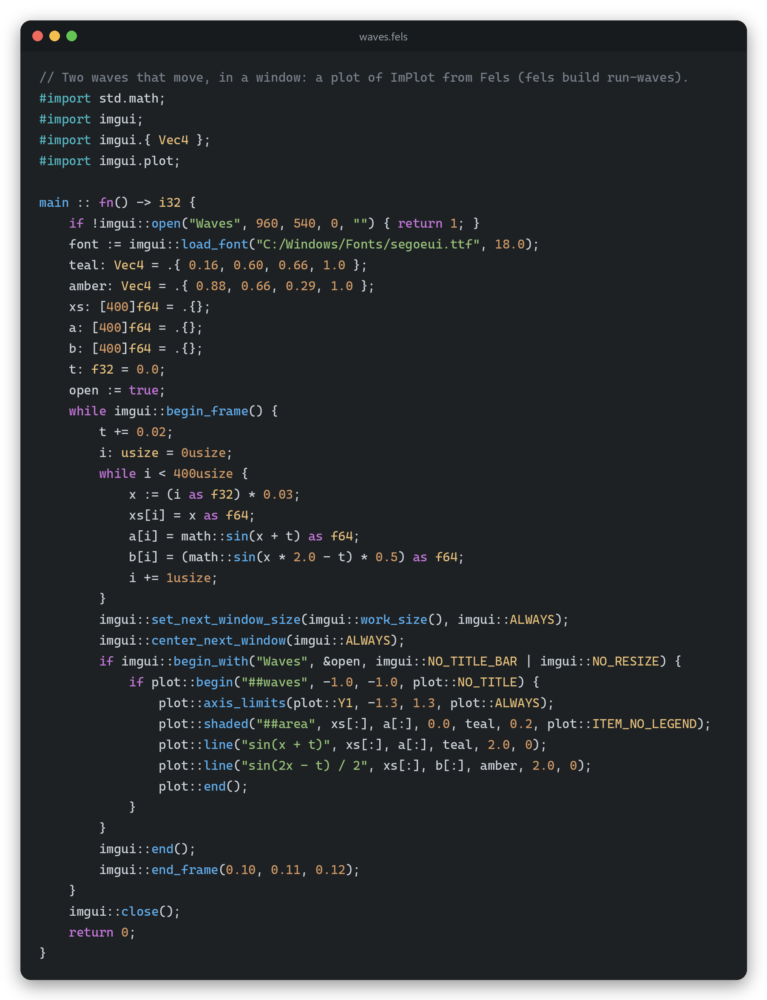
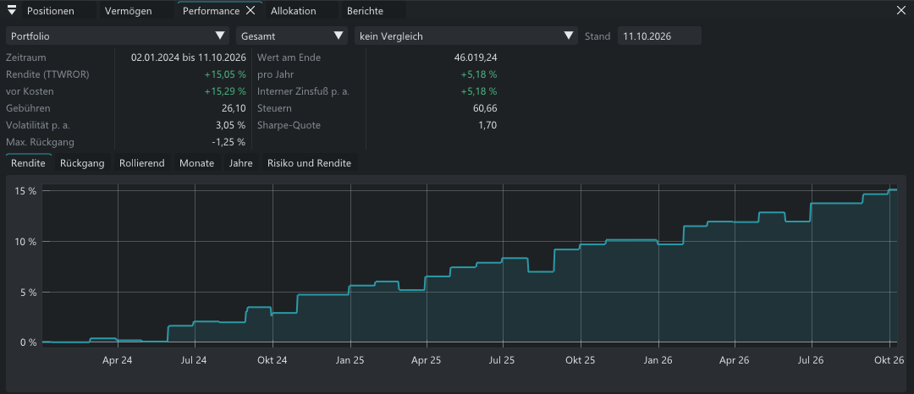
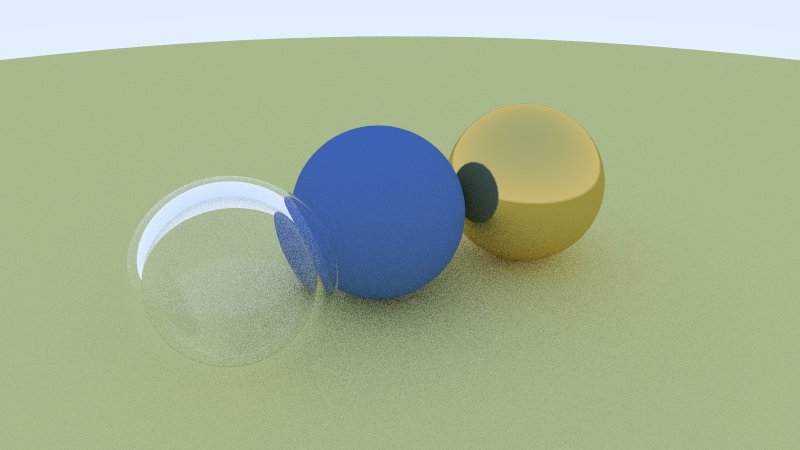

# Fels

Fels is a small systems language for people who like to know what their code does. It compiles
to native code through LLVM and has no garbage collector. Everything you need comes in one tool:
the compiler, a build system, a test runner, a package manager and even its own linker.

<p align="center">
  
</p>
<p align="center"><sub>A window with a live chart, in about 40 lines of Fels.
The code is <a href="https://github.com/fels-lang/imgui/blob/main/examples/waves.fels">here</a>.</sub></p>

## Why I made it

I wanted a language that stays close to the machine, like C, but is harder to get wrong and easy
to keep in your head. So Fels has a few ideas and tries to do them well:

- Memory lives in zones, and a zone is freed when its block ends.
- Errors are plain values that you check, not exceptions that fly past you.
- Code can run while the program compiles.
- One tool builds your project, runs its tests and fetches its packages.

Fels is young, and the language still changes. But it is not a toy: I write real programs in it.
The biggest one is Strata, an app for my own investments. Building it turned up a lot of bugs in
the compiler, and I fixed them along the way.

## Install

Fels runs on 64-bit Windows and Linux, and builds programs for both. The
[latest release](https://github.com/fels-lang/fels/releases/latest) has a download for each.

On Windows:

1. Download `fels-0.13.0-x86_64-windows.zip`.
2. Unpack it and run `install.ps1` in that folder. It copies Fels to `%LOCALAPPDATA%\fels` and
   puts it on your PATH.
3. Open a new terminal and type `fels version` to check that it works.

On Linux:

1. Download `fels-0.13.0-x86_64-linux.tar.gz` and unpack it.
2. Run `./install.sh` in that folder. It copies Fels to `~/.fels` and puts it on your PATH.
3. Open a new terminal and type `fels version`. Fels needs the C++ runtime of GCC 11 or newer
   (Ubuntu 22.04, Debian 12, Fedora 35 and later).

## Your first program

`fels new` sets up a project with a build file, a small program and a test:

```text
fels new hello
cd hello
fels build run
fels test
```

This is the `src/main.fels` it writes for you:

```fels
#import std.io;

// The sum of the numbers from 1 to `n`.
sum_to :: fn(n: i32) -> i32 {
    total := 0;
    i := 1;
    while i <= n {
        total += i;
        i += 1;
    }
    return total;
}

main :: fn() -> i32 {
    io::println("Hello from hello!");
    io::println("1 + 2 + ... + 10 = {sum_to(10)}");
    return 0;
}

#test
sum_to_adds_the_numbers :: fn(t: *Test) {
    t.eq(sum_to(0), 0);
    t.eq(sum_to(1), 1);
    t.eq(sum_to(10), 55);
}
```

## Memory in zones

A zone is an arena with a name and a block. Whatever you allocate in it lives until the block
ends, and then all of it goes away in one step. You never call `free`, and nothing runs in the
background to clean up after you.

<p align="center"></p>

The compiler keeps track of what belongs to a zone, so nothing slips out of its block by
accident. This, for example, does not compile:

<p align="center"></p>

## Errors are values

A function that can fail says so in its type, as in `-> i32 ! ParseError`. Inside it, `fail`
returns an error. The caller passes it on with `?` or handles it with `catch`, where `yield` can
give a value to use instead. An error can carry a payload, and `match` reads both. There are no
exceptions, and nothing unwinds the stack.

<p align="center"></p>

## Code that runs while it compiles

`#run` calls a function while your program is being compiled, and the result goes into the
binary as a constant. A macro writes code from a template, and the compiler checks that code
just like code you typed yourself.

<p align="center"></p>

Compile-time code runs on a small virtual machine. It reads the same IR as the native backend, so
it behaves the same way. Build files and tests can run there too.

## Close to the machine

Fels talks to C without glue code. `fels bindgen` turns a C header into Fels declarations,
`#extern` calls a function in a DLL, and `#export` hands your own functions to C. Structs keep
C's layout. `#packed` removes the padding, a packed struct with `u1` to `u7` fields gives you bit
fields, and a `union` overlays its fields the way C does. The Win32 examples and the COM support
in the standard library are built on this.

The safety checks stay on in release builds. Index bounds, null pointers, integer overflow and
division by zero are checked, unless you ask for `fels build --release-fast`.

## One tool

The build file is a Fels program as well, and the compiler runs it at compile time:

<p align="center"></p>

- `fels build` builds your project, and `fels build run` runs it. `fels run hello.fels` builds
  and runs a single file.
- `fels test` runs every `#test` function, and `fels test --filter parse` the ones with `parse`
  in their name.
- `fels add imgui github.com/fels-lang/imgui` adds a package from a Git repository, and a lock
  file pins its version.
- `fels lsp` gives your editor errors, completion, hover and go to definition. Completion
  writes the whole call, with a tab stop at each argument, and hover shows the comment above a
  declaration. There is an extension for [Zed](https://github.com/fels-lang/zed-fels), with run
  buttons beside `main` and each test, and a
  [tree-sitter grammar](https://github.com/fels-lang/tree-sitter-fels) for other editors.
- `fels bindgen` turns a C header into Fels bindings.

Fels even brings its own linker. `felsld` is written in Fels, writes Windows executables and DLLs,
and links itself. The release builds it into `fels.exe`, so you don't need LLD to link.

## A GUI in Fels

The [imgui package](https://github.com/fels-lang/imgui) brings Dear ImGui with docking, and
ImPlot for charts. This is all the code behind the window at the top:

<p align="center"></p>

## What I build with it

**Strata** is a desktop app for my investments. It keeps accounts, depots and transactions in
SQLite and shows performance, risk, allocation and reports. It imports bank exports and loads
prices from the web. It is written in Fels with the imgui, sqlite, http and decimal packages. It
is not public yet, and its screens are in German for now.

<p align="center"></p>

The [examples](examples/) folder has more to look at:

- `raytracer` renders spheres of glass and metal into a BMP file.
- `mandel` draws a Mandelbrot set, all of it computed at compile time.
- `raycaster` lets you walk through a 3D maze in the terminal.
- `diskscan` is a disk analyzer with a Win32 GUI and threads.
- `ecs_game`, `bf` (a Brainfuck interpreter), `dll`, `capability` and more.

<p align="center"></p>

## Packages

| Package | What it does |
| --- | --- |
| [imgui](https://github.com/fels-lang/imgui) | Dear ImGui with docking, a ready window and ImPlot charts |
| [sqlite](https://github.com/fels-lang/sqlite) | SQLite 3 |
| [http](https://github.com/fels-lang/http) | HTTP and HTTPS through WinHTTP |
| [decimal](https://github.com/fels-lang/decimal) | Exact decimal numbers for money |

The standard library lives in [`lib/std`](lib/std/). It has collections, files, processes,
threads, sockets, JSON, CSV, dates and more, and [docs/07_stdlib.md](docs/07_stdlib.md) lists it
all.

## Where it stands

- Windows x64 works from end to end.
- Linux x64 works from end to end too: the compiler runs there and builds static executables.
- There is no macOS support and no formatter yet.
- `-g` gives a program debug info: source lines, functions, parameters and locals with their
  types, in a PDB on Windows and as DWARF on Linux. On Windows it needs the import libraries of
  the Windows SDK for now.
- Programs can run without an operating system: `--target uefi` makes a UEFI application and
  `--target freestanding` an ELF for a kernel. `examples/uefi` and `examples/kernel` boot in
  QEMU.
- The compiler has 856 tests, and CI runs them on Windows and Linux on every push.

[KNOWN_ISSUES.md](KNOWN_ISSUES.md) lists what is still rough, and the
[changelog](CHANGELOG.md) shows what changed in each release.

## Documentation

The language reference is in [docs](docs/). These are good places to start:

- [Overview](docs/00_overview.md)
- [Syntax](docs/01_syntax.md)
- [Memory and zones](docs/05_memory_zones.md)
- [Compile time](docs/09_comptime.md) and [metaprogramming](docs/13_metaprogramming.md)
- [Packages](docs/16_packages.md)

## Try it and tell me

If you try Fels, I would love to hear how it went. Open an
[issue](https://github.com/fels-lang/fels/issues) for a bug, a question or an idea. Small
programs that show a problem help the most.

## Building Fels

The compiler is written in Zig 0.16. You need an LLVM build that includes its C headers: on
Linux, llvm.org's release (`LLVM-22.1.6-Linux-X64.tar.xz`, which the build links statically), on
Windows `clang+llvm-22.1.6-x86_64-pc-windows-msvc.tar.xz`.

```text
zig build -Dllvm-path=path/to/llvm
zig build test -Dllvm-path=path/to/llvm
```

The compiler lands in `zig-out/bin`.

## License

The compiler is under the [GPL v3](LICENSE-GPLv3.txt). The runtime and the standard library are
under [Apache 2.0](LICENSE-APACHE-2.0.txt). Your programs only contain the second part, so they
are yours, and you can license and ship them as you like. [LICENSING.md](LICENSING.md) has the
details.
