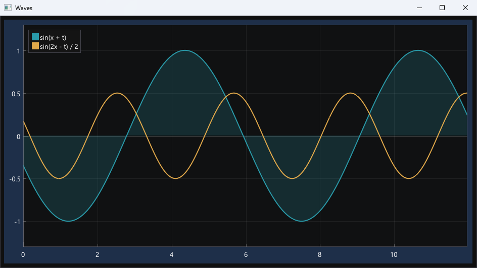
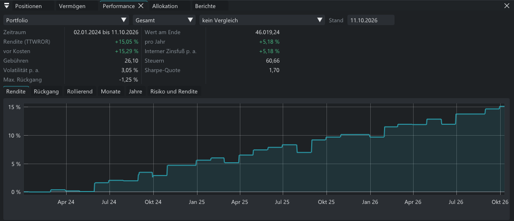
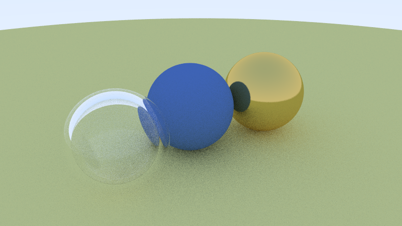

<p align="center">
  
</p>
<p align="center">A small systems language for people who like to know what their code does.</p>
<p align="center">
  <a href="https://github.com/fels-lang/fels/releases/latest"></a>
  
  <a href="https://github.com/fels-lang/fels/actions/workflows/ci.yml"></a>
  <a href="LICENSING.md"></a>
</p>

# The Fels Programming Language

Fels is a small systems language for people who like to know what their code does. It compiles
to native code through LLVM and has no garbage collector. Everything you need comes in one tool:
the compiler, a build system, a test runner, a package manager and even its own linker.

**Website and docs: [fels-lang.github.io](https://fels-lang.github.io)**

<p align="center">
  
</p>
<p align="center"><sub>A window with a live chart, in about 40 lines of Fels.
The code is <a href="https://github.com/fels-lang/imgui/blob/main/examples/waves.fels">here</a>.</sub></p>

## Why I made it

I wanted a language that stays close to the machine, like C, but is harder to get wrong and easy
to keep in your head. So Fels has a few ideas and tries to do them well:

- Memory lives in zones, and a zone is freed when its block ends.
- Errors are plain values that you check, not exceptions that fly past you.
- Code can run while the program compiles.
- One tool builds your project, runs its tests and fetches its packages.

Fels is young, and the language still changes. But it is not a toy: I write real programs in it.
The biggest one is Strata, an app for my own investments. Building it turned up a lot of bugs in
the compiler, and I fixed them along the way.

## Install

Download Fels for 64-bit Windows or Linux from the
[latest release](https://github.com/fels-lang/fels/releases/latest), unpack it and run
`install.ps1` (Windows) or `./install.sh` (Linux). Then:

```text
fels new hello
cd hello
fels build run
```

[Install](https://fels-lang.github.io/start/install/) and
[your first program](https://fels-lang.github.io/start/first-program/) on the website go
through it step by step.

## What it looks like

```fels
#import std.io;

// How many different bytes are in `text`?
count_distinct :: fn(text: []const u8) -> usize {
    zone scratch: Arena {
        seen := scratch.new_slice(bool, 256);
        for i in 0..256 { seen[i] = false; }
        n: usize = 0;
        for b in text {
            if !seen[b] { seen[b] = true; n += 1; }
        }
        return n;
    }   // `seen` is gone here, all at once
}

main :: fn() -> i32 {
    n := count_distinct("hello, world");
    io::println("{n} different bytes");
    return 0;
}
```

The website walks through the rest: [zones](https://fels-lang.github.io/docs/memory-zones/),
[errors as values](https://fels-lang.github.io/docs/error-handling/),
[code that runs while it compiles](https://fels-lang.github.io/docs/comptime/),
[C without glue](https://fels-lang.github.io/docs/c-interop/) and
[the build tool](https://fels-lang.github.io/docs/build-system/).

## What I build with it

**Strata** is a desktop app for my investments. It keeps accounts, depots and transactions in
SQLite and shows performance, risk, allocation and reports. It imports bank exports and loads
prices from the web. It is written in Fels with the imgui, sqlite, http and decimal packages. It
is not public yet, and its screens are in German for now.

<p align="center"></p>

The [examples](examples/) folder has more to look at:

- `raytracer` renders spheres of glass and metal into a BMP file.
- `mandel` draws a Mandelbrot set, all of it computed at compile time.
- `raycaster` lets you walk through a 3D maze in the terminal.
- `diskscan` is a disk analyzer with a Win32 GUI and threads.
- `ecs_game`, `bf` (a Brainfuck interpreter), `dll`, `capability` and more.

<p align="center"></p>

## Packages

| Package | What it does |
| --- | --- |
| [imgui](https://github.com/fels-lang/imgui) | Dear ImGui with docking, a ready window and ImPlot charts |
| [sqlite](https://github.com/fels-lang/sqlite) | SQLite 3 |
| [http](https://github.com/fels-lang/http) | HTTP and HTTPS through WinHTTP |
| [decimal](https://github.com/fels-lang/decimal) | Exact decimal numbers for money |

The standard library lives in [`lib/std`](lib/std/). It has collections, files, processes,
threads, sockets, JSON, CSV, dates and more, and [docs/07_stdlib.md](docs/07_stdlib.md) lists it
all.

## Where it stands

- Windows x64 works from end to end.
- Linux x64 works from end to end too: the compiler runs there and builds static executables.
- There is no macOS support and no formatter yet.
- `-g` gives a program debug info: source lines, functions, parameters and locals with their
  types, in a PDB on Windows and as DWARF on Linux. On Windows it needs the import libraries of
  the Windows SDK for now.
- Programs can run without an operating system, on x86-64 and 64-bit ARM: `--target uefi` makes
  a UEFI application and `--target freestanding` an ELF for a kernel, with interrupt handlers
  as functions. `examples/uefi`, `examples/kernel` and `examples/kernel_aarch64` boot in QEMU.
- The compiler has 863 tests, and CI runs them on Windows and Linux on every push.

[KNOWN_ISSUES.md](KNOWN_ISSUES.md) lists what is still rough, and the
[changelog](CHANGELOG.md) shows what changed in each release.

## Documentation

Everything is on [fels-lang.github.io](https://fels-lang.github.io): how to install, a first
program, and the whole language reference. The pages are made from [docs](docs/) in this repo.

## Try it and tell me

If you try Fels, I would love to hear how it went. Open an
[issue](https://github.com/fels-lang/fels/issues) for a bug, a question or an idea. Small
programs that show a problem help the most.

## Building Fels

The compiler is written in Zig 0.16. You need an LLVM build that includes its C headers: on
Linux, llvm.org's release (`LLVM-22.1.6-Linux-X64.tar.xz`, which the build links statically), on
Windows `clang+llvm-22.1.6-x86_64-pc-windows-msvc.tar.xz`.

```text
zig build -Dllvm-path=path/to/llvm
zig build test -Dllvm-path=path/to/llvm
```

The compiler lands in `zig-out/bin`.

## License

The compiler is under the [GPL v3](LICENSE-GPLv3.txt). The runtime and the standard library are
under [Apache 2.0](LICENSE-APACHE-2.0.txt). Your programs only contain the second part, so they
are yours, and you can license and ship them as you like. [LICENSING.md](LICENSING.md) has the
details.
